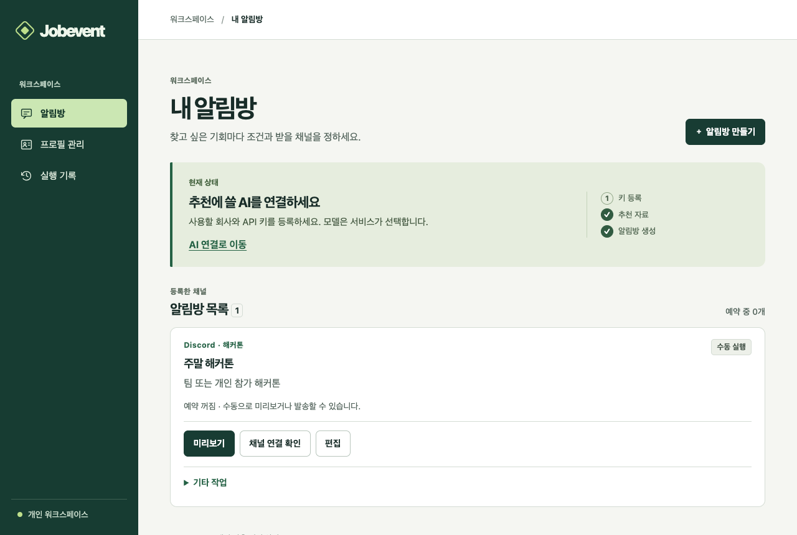

# Jobevent

**공고를 찾는 시간은 줄이고, 지원할지 결정하는 데 집중하세요.** Jobevent는 가입자가 자기 AI 키와 프로필을 등록하면, 조건에 맞는 모집 공고를 찾아 본인의 Discord·Slack 채널로 보내는 웹 서비스입니다. 개발자와 서비스 이용자는 별개입니다. 이용자는 GitHub 계정이나 앱 설치가 필요 없습니다.

**[서비스 시작하기](https://jobevent.vercel.app)** · [제품 명세와 모바일 확장 기준](docs/product-spec.md)

휴대폰 브라우저에서도 가입하고 홈 화면에 추가할 수 있습니다. Vercel은 시작 링크이고, 실제 회원가입·키 입력은 연결된 HTTPS 서비스에서 처리합니다.



## 처음 쓰기

1. 서비스의 **회원가입**에서 아이디와 비밀번호를 정합니다. 이메일은 수집하지 않습니다. 비밀번호 관리자에 저장하세요.
2. **프로필 관리** 한 화면에서 AI 연결, 내 자료, 내 공개 링크를 관리합니다. AI 연결에서는 회사(OpenAI·Google Gemini·Anthropic Claude)와 키만 등록하고 모델은 서비스가 지정합니다. 이력서는 **내 자료**에 파일(PDF·TXT·MD)이나 글로 저장하고, GitHub·자기소개 사이트는 **내 공개 링크**에 한 번만 저장하세요. 링크 본문을 직접 작성하거나 가져와서 확인·수정할 수 있고 자동으로 다시 읽지 않습니다. 별도 자기소개는 필요 없습니다.
3. **알림방 만들기**에서 채용, 인턴, 동아리·연합, 공모전, 해커톤, 교육, 장학·펠로십, 오픈소스 또는 직접 정의를 선택합니다. 검색해도 되는 조건과 비공개 선별 기준을 구분하세요. 방마다 모든 자료(앞으로 추가할 자료 포함) 또는 직접 고른 자료만 쓰고, 공개 링크 포함 여부도 별도로 설정할 수 있습니다.
4. 원하는 채널의 웹훅을 입력합니다. [Discord](https://support.discord.com/hc/en-us/articles/228383668-Intro-to-Webhooks)는 서버 설정 → 연동 → 웹후크, [Slack](https://docs.slack.dev/messaging/sending-messages-using-incoming-webhooks/)은 앱 → Incoming Webhooks → 워크스페이스에 추가 → 채널 선택에서 발급합니다.
5. 말투, 시간대, 요일, 현지 시각, 최대 건수를 정하고 저장합니다. **채널 연결 확인**은 AI를 호출하지 않고 고정된 확인 메시지 한 건만 보냅니다. **미리보기**는 검색·추천까지만 합니다. 15분 안에 **이 결과 그대로 발송**을 누르면 추가 검색 비용 없이 확인한 목록에서 아직 마감되지 않은 미발송 항목만 보냅니다. **새로 검색해 발송**은 별도의 유료 검색입니다. 예약은 별도로 켭니다. 브라우저와 사용자 PC를 꺼도 운영 서버의 워커가 실행됩니다.

예: 평일 오전 9시엔 Slack에 서울 백엔드 인턴 3건을 짧은 존댓말로, 토요일 오후 2시엔 Discord에 대학생 해커톤 2건을 친근한 말투로 받을 수 있습니다. 두 방의 발송 이력은 서로 독립적입니다.

## 어떤 공고를 찾나요?

| 방식 | 언제 쓰나요? | 제한 |
|---|---|---|
| 회사별 검색: [OpenAI](https://developers.openai.com/api/docs/guides/tools-web-search) · [Google](https://ai.google.dev/gemini-api/docs/google-search) · [Anthropic](https://platform.claude.com/docs/en/agents-and-tools/tool-use/web-search-tool) | 국내외 채용·동아리·대회 등 넓게 발굴 | 검색 호출에서 인용된 HTTPS URL만 추천 후보. 모든 공고를 망라하지 않으며 모집 상태·자격은 원문 확인 |
| [Greenhouse](https://docs.greenhouse.io/job-board.html) | 지정한 회사의 현재 공개 보드 | 보드 식별자 필요. 최근 갱신 순 최대 50개 후보 |
| [Lever](https://github.com/lever/postings-api) / EU | 지정한 회사의 공개 채용 목록 | 회사 식별자·리전 필요. 최대 50개 후보 |

웹 검색과 추천은 사용자 API 요금이 발생할 수 있습니다. 회사 보드 모드는 웹 검색 비용 없이 추천 모델만 호출합니다. 방별 최대 건수는 **발송량 제한**이지 금액 상한이 아닙니다. AI의 추천은 합격·자격·마감 보증이 아닙니다. 인증형 국내 공공 API와 근거 없는 생성 링크를 기본 소스로 넣지 않았습니다.

## 데이터와 실행 구조

브라우저 → Django 세션/CSRF → 회원별 저장소 → 수집 → 도구 없는 맞춤 추천 → 방별 중복 확인 → 웹훅. 같은 데이터에 접근하는 웹과 워커는 회원별 잠금을 공유합니다. 검색에는 공개 검색어만 보내고 AI 키·웹훅을 브라우저로 돌려주지 않습니다. 프로필은 추천 시 선택한 제공 회사의 모델로 전송되며 추천 문구는 채널에서 보입니다. [개인정보·보안 경계](SECURITY.md)를 확인하세요.

공유 서버에서 직접 가져오는 포트폴리오는 GitHub Pages, Vercel, Notion 기본 서브도메인의 공개 정적 본문입니다. 로그인이나 자바스크립트 렌더링이 필요한 페이지, 커스텀 도메인은 본문 붙여넣기나 파일 업로드를 사용하세요. PDF는 텍스트 기반 4MB·40쪽 이하이며 스캔 OCR은 지원하지 않습니다.

## 개발·배포

```sh
git clone https://github.com/ghdtjdwn/jobevent.git
cd jobevent
uv sync --locked
uv run python deploy/dev.py
```

개발 환경에서 `http://127.0.0.1:8000/signup`을 엽니다. 공개 서비스는 [Docker Compose + HTTPS 운영 안내](docs/operations.md)를 따르세요. 개인 PC 안에서만 실행하는 별도 모드는 `uv run jobevent`이며, 이때는 OS 자격 증명 저장소를 쓰고 PC가 켜져 있어야 합니다. Linux 로컬 모드는 로그인 세션의 Secret Service가 필요합니다. 공개 서비스 이용자에게는 해당되지 않습니다.

- [화면 설계와 실제 서비스 패턴 비교](DESIGN.md) · [협업 가이드](CONTRIBUTING.md) · [보안 신고](SECURITY.md) · [폼팩터 비교와 유사 사례 8개](docs/design.md)
- Python 3.11+, Django, SQLite, 독립 워커. MIT License.
